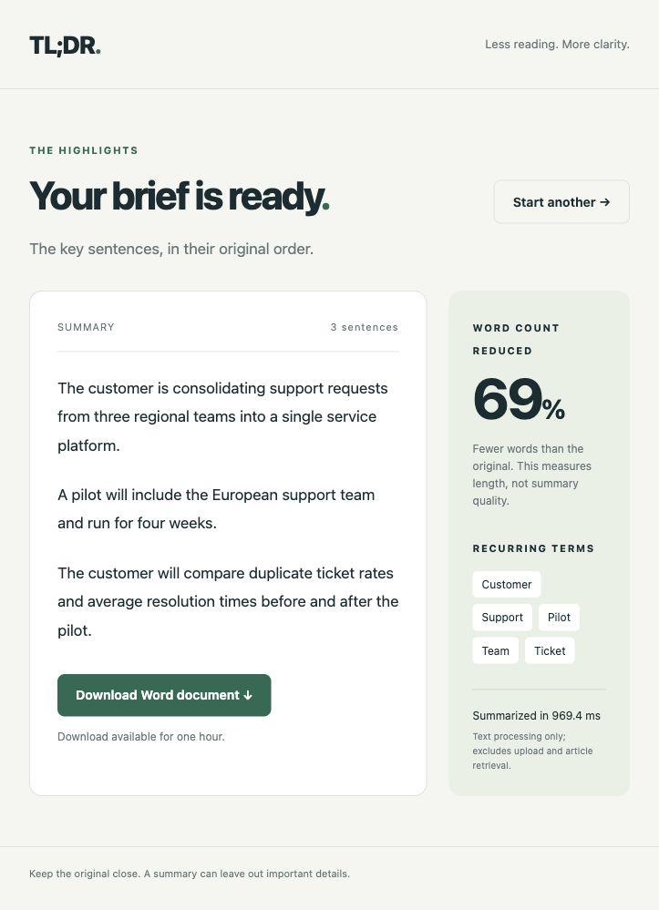
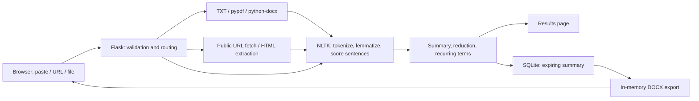

# TL;DR — document summarization demo

A solo project by [Akheel](https://github.com/a-akheel): a web app that turns pasted text, public articles, and uploaded documents into adjustable extractive summaries with Word export. Designed as a demonstrable workflow for reviewing reports, discovery notes, and incident recaps.

[Case study](docs/portfolio.md) · [Two-minute demo guide](docs/demo.md) · [Benchmark results](docs/benchmark-results.json)



## What it does

- Accepts pasted text, public HTML article URLs, and TXT/PDF/DOCX uploads.
- Selects 3–30 sentences, retaining the source wording and original order.
- Reports word-count reduction, recurring terms, and summarization time.
- Exports the most recent summary as a DOCX document.
- Includes a one-click synthetic sample for a repeatable demonstration.

This is frequency-based **extractive** summarization. It does not use an LLM, invent new sentences, or guarantee that every important fact appears. No user adoption, customer outcome, or measured reading-time improvement is claimed.

## Run locally

Use Python 3.12 or newer. Local checks were run with Python 3.14.8; CI is configured for Python 3.12.

```sh
python3 -m venv .venv
source .venv/bin/activate
python -m pip install -r requirements.lock.txt
python -m nltk.downloader -d nltk_data stopwords punkt_tab wordnet
export NLTK_DATA="$PWD/nltk_data"
export SECRET_KEY="$(python -c 'import secrets; print(secrets.token_hex(32))')"
python -m flask --app app run --port 5055
```

Open <http://127.0.0.1:5055> and click **Try a sample**, then **Create summary**. DOCX/PDF parsing needs no Java service. Scanned PDFs require OCR, which is not included.

`requirements.txt` lists direct dependency ranges; `requirements.lock.txt` records the exact versions used for the verified rebuild.

## Architecture



**Stack:** Python, Flask/Jinja, NLTK, pypdf, python-docx, Beautiful Soup, urllib3, SQLite, plain HTML/CSS/JavaScript, Gunicorn, and GitHub Actions.

Sentence scores use mean content-word frequency, with an optional boost for article-title overlap. The highest-scoring sentences are returned in source order. The method is inexpensive and inspectable, but can miss unique facts, dates, or action items that contain infrequent words.

## Verification and measurements

```sh
export NLTK_DATA="$PWD/nltk_data"
python -m unittest discover -s tests -v
python scripts/benchmark.py
```

The rebuilt app passed **18 local automated tests** covering paste, all three upload formats, URL input, export, input validation, session isolation, expiry, HTML escaping, and public-URL protections. CI runs the same suite on pushes and pull requests; its status is separate from the local result.

Measured on October 7, 2026, with 30 warm runs per bundled synthetic sample and a three-sentence summary:

| Sample | Input → output words | Word reduction | Median / p95 processing time |
|---|---:|---:|---:|
| Customer rollout | 142 → 44 | 69% | 2.68 / 2.86 ms |
| Discovery notes | 126 → 35 | 72% | 2.68 / 2.74 ms |
| Incident review | 118 → 37 | 69% | 2.63 / 2.66 ms |

These are short synthetic documents on one local machine. Timings cover the warm summarizer only, excluding first-use resource loading, article retrieval, file parsing, export, and rendering. The browser displays actual per-request summarization time, so the first request can be substantially slower. Compression is not a quality score or evidence of reading-time savings. Environment and raw measurements are in [benchmark-results.json](docs/benchmark-results.json).

## Demo deployment

A public deployment is not included in this repository. For a single-instance demo with a persistent writable filesystem:

```sh
export NLTK_DATA="$PWD/nltk_data"
# Set a stable SECRET_KEY in your hosting provider's secret settings.
# Set COOKIE_SECURE=1 when the app is served over HTTPS.
gunicorn --workers 2 --bind 0.0.0.0:8000 app:app
```

The existing `Procfile` also starts Gunicorn. Provision language resources during deployment. Use one shared, stable `SECRET_KEY` across workers; without it, the local fallback key changes at restart and may differ across workers. SQLite lives in `instance/` and must be accessible to every worker on that instance. Multiple hosts need shared storage and a suitable database/session design.

## Data handling and limits

- Uploaded files are read in memory; original uploads are not saved.
- The browser session contains a summary identifier and form token, not document text.
- Summaries remain accessible for one hour. Expired records are removed on the next summary or download request; this is opportunistic cleanup, not scheduled deletion. Creating a new summary replaces that browser session's previous summary.
- Limits: 5 MB per request, 100,000 extracted characters, 100 PDF pages, and 2 MB of retrieved HTML.
- URL fetching accepts public HTTP/HTTPS destinations on ports 80/443, validates every redirect, pins the validated IP, and preserves HTTPS certificate checks. A hosted service should also enforce outbound network controls and request rate limits.
- Article extraction uses paragraph text within an `article`, `main`, or page body. Paywalls, JavaScript-only content, and unusual page layouts may require pasted text.
- This portfolio demo has no accounts, OCR, semantic quality evaluation, or production-scale load validation.

## Ownership and rebuild

The owner confirmed the original project was built solo. The original app source was recovered from this repository's `main` branch. The current portfolio rebuild was implemented with Codex assistance: updated interface and dependencies, portable parsing/export, bounded public-URL retrieval, server-side storage, tests, documentation, and reproducible measurements. The bundled customer scenarios are fictional.
